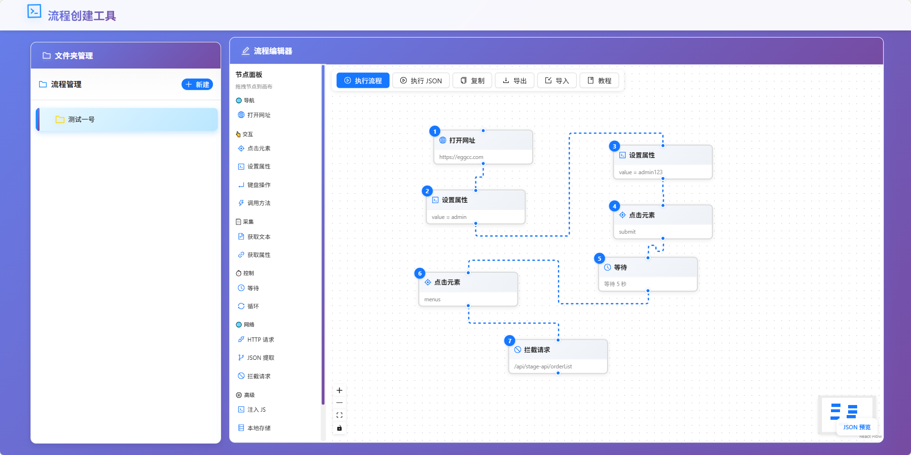

# 🕷️ Flow Crawler - 可视化爬虫流程编辑器

> 一个基于 JSON 的可视化爬虫流程编辑器，通过拖拽配置完成复杂的网页自动化任务


---

## 📋 项目简介

这是一个专为爬虫开发者设计的可视化工具，通过拖拽配置的方式创建爬虫流程，无需编写代码即可完成复杂的网页自动化任务。

**核心特性：**
- ✅ **可视化配置**：基于 React Flow 的节点连线图编辑器，拖拽创建流程
- ✅ **实时预览**：右下角实时查看生成的 JSON 配置
- ✅ **一键执行**：直接在浏览器中执行或调用 Python 后端执行
- ✅ **变量管理**：支持变量存储和引用（`${变量名}` 语法）
- ✅ **数据拦截**：支持拦截和修改 HTTP 请求
- ✅ **循环处理**：支持按次数、按元素、按变量三种循环方式
- ✅ **定时任务**：支持 Cron 表达式和定时触发，循环执行指定步骤范围
- ✅ **导入导出**：支持 JSON 配置的导入、导出和回填

---

## 🗂️ 项目目录结构

整个项目分为前端和后端两个独立目录，各自负责不同职责：



```
flow-crawler/
├── python-backend/          # Python 后端 - Playwright 执行引擎
│   ├── app/
│   │   ├── api/             # FastAPI 接口层
│   │   │   └── server.py    # API 路由与服务器配置
│   │   ├── core/            # 核心执行逻辑
│   │   │   ├── command_handler.py  # 步骤命令分发
│   │   │   ├── executor.py         # 流程执行器
│   │   │   ├── variable_manager.py # 变量管理器
│   │   │   └── logger.py           # 日志模块
│   │   ├── models/          # 数据模型
│   │   └── utils/           # 工具函数
│   ├── data/
│   │   ├── flows/           # 流程配置 JSON 存储
│   │   └── outputs/         # 执行输出文件
│   ├── main.py              # 启动入口
│   ├── server.py            # 服务器启动脚本
│   └── requirements.txt     # Python 依赖清单（含 croniter）
│
└── react-app/               # React 前端 - 可视化图编辑器
    └── src/
        ├── components/
        │   ├── FolderTree/  # 文件夹树组件
        │   └── GraphEditor/ # 图编辑器核心组件
        │       ├── GraphEditor.tsx      # 画布主组件
        │       ├── StepNode.tsx         # 自定义节点组件
        │       ├── NodePalette.tsx      # 节点拖拽面板
        │       └── NodeConfigPanel.tsx  # 右侧配置面板
        ├── store/           # Zustand 状态管理
        │   └── useStore.ts
        ├── types/           # TypeScript 类型定义
        │   ├── index.ts     # 步骤配置类型（17 种）
        │   └── graph.ts     # 图编辑器节点/边类型
        ├── utils/           # 工具函数
        │   ├── exportFlow.ts    # 导出配置（含定时任务循环范围计算）
        │   ├── storage.ts       # 本地持久化
        │   └── migrateData.ts   # 旧数据迁移工具
        └── App.tsx          # 应用入口
```

**目录职责：**
- `python-backend/`：负责接收 JSON 配置并使用 Playwright 执行浏览器自动化流程
- `react-app/`：提供基于 React Flow 的可视化图编辑器，支持节点拖拽、连线和实时预览

---

## 🚀 快速启动

### 📦 环境准备与依赖安装

在开始之前，请确保你的系统已安装以下软件：

#### 1. Python 环境（后端必需）

**Python 版本要求：** Python 3.8 或更高版本（推荐 3.11）

**检查 Python 版本：**
```bash
python --version
# 或
python3 --version
```

**如果没有安装：**
- 访问 [Python 官网](https://www.python.org/) 下载并安装
- Windows 用户请勾选 "Add Python to PATH"

---

#### 2. Node.js 环境（前端必需）

**Node.js 版本要求：** Node.js 16 或更高版本（推荐 18 LTS）

**检查 Node.js 版本：**
```bash
node --version
npm --version
```

**如果没有安装：**
- 访问 [Node.js 官网](https://nodejs.org/) 下载并安装 LTS 版本
- npm 会随 Node.js 一起安装

---

#### 3. 安装 Python 依赖包

**进入后端目录并安装依赖：**
```bash
cd python-backend

# 安装所有依赖包
pip install -r requirements.txt
```

**requirements.txt 包含的依赖：**
```txt
playwright==1.49.1         # 浏览器自动化框架
requests==2.32.3           # HTTP 请求库
jsonpath-ng==1.7.0         # JSONPath 解析
fastapi==0.115.6           # Web API 框架
uvicorn==0.34.0            # ASGI 服务器
pydantic==2.10.4           # 数据验证
python-multipart==0.0.19   # 文件上传支持
croniter==6.0.0            # Cron 表达式解析（定时任务）
```

**验证安装：**
```bash
pip list | findstr playwright
pip list | findstr fastapi
```

---

#### 4. 安装 Playwright 浏览器

**安装 Chromium 浏览器：**
```bash
# 在 python-backend 目录下执行
playwright install chromium
```

**说明：**
- 这一步会下载 Chromium 浏览器（约 136 MB）
- 下载过程可能需要几分钟，取决于网络速度
- 如果下载失败，可以尝试重新执行命令
- Playwright 会自动从备用 CDN 下载

**验证安装：**
```bash
playwright install --help
```

---

#### 5. 安装前端依赖包

**进入前端目录并安装依赖：**
```bash
cd react-app

# 安装所有依赖包
npm install
```

**主要依赖：**
```json
{
  "react": "^18.2.0",
  "react-dom": "^18.2.0",
  "typescript": "^5.0.0",
  "antd": "^5.0.0",
  "zustand": "^4.0.0",
  "tailwindcss": "^3.0.0"
}
```

**说明：**
- `npm install` 会自动读取 `package.json` 并安装所有依赖
- 如果遇到网络问题，可以使用国内镜像：
  ```bash
  npm install --registry=https://registry.npmmirror.com
  ```

**验证安装：**
```bash
npm list --depth=0
```

---

### 方式一：分别启动（推荐）

#### 1. 启动前端（React）

```bash
# 进入前端目录
cd react-app

# 如果依赖未安装，先执行
npm install

# 启动开发服务器
npm run dev
```

**访问地址：** http://localhost:5173

---

#### 2. 启动后端（Python）

```bash
# 进入后端目录
cd python-backend

# 如果依赖未安装，先执行
pip install -r requirements.txt

# 如果浏览器未安装，先执行
playwright install chromium

# 启动 API 服务器
python server.py
```

**API 地址：** http://localhost:8000  
**API 文档：** http://localhost:8000/docs

---

### 方式二：独立启动（适用于生产环境）

**前端构建：**
```bash
cd react-app

# 安装依赖（如果未安装）
npm install

# 构建生产版本
npm run build
```

**后端启动：**
```bash
cd python-backend

# 安装依赖（如果未安装）
pip install -r requirements.txt

# 启动服务器
python server.py
```

---

## 🆘 常见问题

### Q1: pip install 安装失败

**解决方案：**
```bash
# 升级 pip 到最新版本
python -m pip install --upgrade pip

# 使用国内镜像源
pip install -r requirements.txt -i https://pypi.tuna.tsinghua.edu.cn/simple
```

---

### Q2: npm install 安装失败

**解决方案：**
```bash
# 清理缓存
npm cache clean --force

# 使用国内镜像
npm install --registry=https://registry.npmmirror.com

# 删除 node_modules 重新安装
rm -rf node_modules package-lock.json
npm install
```

---

### Q3: Playwright 浏览器下载失败

**解决方案：**
```bash
# 方法 1：重新执行
playwright install chromium

# 方法 2：设置代理
set HTTPS_PROXY=http://proxy.example.com:8080
playwright install chromium

# 方法 3：手动下载（不推荐）
# 访问 https://playwright.dev/docs/browsers 查看下载链接
```

---

### Q4: 端口被占用

**查看占用端口的进程：**
```bash
# Windows
netstat -ano | findstr :8000
taskkill /F /PID <进程ID>

# Mac/Linux
lsof -ti:8000 | xargs kill -9
```

---

### Q5: Python 版本过低

**检查版本：**
```bash
python --version
```

**如果版本低于 3.8，请：**
1. 访问 [Python 官网](https://www.python.org/downloads/) 下载新版本
2. 安装时勾选 "Add Python to PATH"
3. 重新安装依赖：
   ```bash
   pip install -r requirements.txt
   ```

---

### Q6: Node.js 版本过低

**检查版本：**
```bash
node --version
```

**如果版本低于 16，请：**
1. 访问 [Node.js 官网](https://nodejs.org/) 下载 LTS 版本
2. 安装新版本 Node.js
3. 重新安装依赖：
   ```bash
   npm install
   ```

---

## 📖 使用教程

### 🎯 快速开始（4 步完成配置）

#### 步骤 1：选择文件夹
在左侧树形结构中选择一个文件夹，该文件夹对应一个独立画布页。

#### 步骤 2：添加节点
从左侧**节点面板（NodePalette）**拖拽步骤节点到画布，节点按拖入顺序自动编号。

#### 步骤 3：连线与配置
- 从节点底部**拖出连线**到下一个节点，建立执行顺序
- 点击节点打开右侧**配置面板（NodeConfigPanel）**，配置参数
- 定时任务节点可**向上回连**，形成循环执行范围

#### 步骤 4：执行或导出
- **执行 JSON**：点击顶部"执行 JSON"按钮，直接在浏览器中运行流程
- **复制 JSON**：点击右下角"复制"按钮，获取配置供 Python 使用
- **导出文件**：点击"导出文件"按钮，保存为本地 JSON 文件

---

## 🔥 实战案例

### 案例 1：登录并采集数据

**场景：** 自动登录网站，拦截 API 请求修改分页参数，批量采集商品数据

**流程配置：**

```json
{
  "name": "登录并采集数据",
  "version": "1.0",
  "description": "演示完整的登录、拦截、采集流程",
  "task": [
    {
      "name": "登录流程",
      "action": [
        {
          "id": 1,
          "type": "openBrower",
          "name": "打开网址",
          "data": {
            "url": "https://example.com/login"
          }
        },
        {
          "id": 2,
          "type": "setAttribute",
          "name": "设置属性",
          "data": {
            "selectorType": "id",
            "selectorValue": "username",
            "attributeName": "value",
            "attributeValue": "your_username"
          }
        },
        {
          "id": 3,
          "type": "setAttribute",
          "name": "设置属性",
          "data": {
            "selectorType": "id",
            "selectorValue": "password",
            "attributeName": "value",
            "attributeValue": "your_password"
          }
        },
        {
          "id": 4,
          "type": "clickBrowerElement",
          "name": "点击元素",
          "data": {
            "selectorType": "id",
            "selectorValue": "login-btn"
          }
        },
        {
          "id": 5,
          "type": "wait",
          "name": "等待",
          "data": {
            "duration": 3
          }
        }
      ]
    },
    {
      "name": "采集流程",
      "action": [
        {
          "id": 6,
          "type": "clickBrowerElement",
          "name": "点击元素",
          "data": {
            "selectorType": "css",
            "selectorValue": ".menu-item:nth-child(2)"
          }
        },
        {
          "id": 7,
          "type": "clickBrowerElement",
          "name": "点击元素",
          "data": {
            "selectorType": "id",
            "selectorValue": "search-btn"
          }
        },
        {
          "id": 8,
          "type": "interceptRequest",
          "name": "拦截请求",
          "data": {
            "urlPattern": "*/api/products/list*",
            "method": "POST",
            "modifyRequestBody": true,
            "requestBody": "{\n  \"page\": 1,\n  \"pageSize\": 100,\n  \"keyword\": \"\"\n}",
            "continueRequest": true,
            "saveVariable": "interceptedRequest"
          }
        },
        {
          "id": 9,
          "type": "wait",
          "name": "等待",
          "data": {
            "duration": 5
          }
        },
        {
          "id": 10,
          "type": "loop",
          "name": "循环",
          "data": {
            "loopType": "bySelector",
            "selectorType": "class",
            "selectorValue": "product-item",
            "currentItemVariable": "product",
            "children": [
              {
                "id": 101,
                "type": "getText",
                "name": "获取文本",
                "data": {
                  "selectorType": "class",
                  "selectorValue": "product-name",
                  "saveVariable": "productName"
                }
              },
              {
                "id": 102,
                "type": "getText",
                "name": "获取文本",
                "data": {
                  "selectorType": "class",
                  "selectorValue": "product-price",
                  "saveVariable": "productPrice"
                }
              },
              {
                "id": 103,
                "type": "getAttribute",
                "name": "获取属性",
                "data": {
                  "selectorType": "class",
                  "selectorValue": "product-link",
                  "attributeName": "href",
                  "saveVariable": "productLink"
                }
              }
            ]
          }
        }
      ]
    }
  ]
}
```

**流程说明：**

1. **登录流程**
   - 打开登录页面
   - 输入账号密码
   - 点击登录按钮
   - 等待 3 秒

2. **采集流程**
   - 进入商品菜单
   - 点击查询按钮
   - **拦截请求**：修改分页参数，强制返回 100 条数据
   - 等待 5 秒（数据加载）
   - **循环处理**：遍历所有商品项，提取名称、价格、链接

---

### 案例 2：简单的数据导出

**场景：** 定期访问页面，提取数据并保存到变量

```json
{
  "name": "简单数据导出",
  "version": "1.0",
  "description": "访问页面并提取数据",
  "task": [
    {
      "name": "数据采集",
      "action": [
        {
          "id": 1,
          "type": "openBrower",
          "name": "打开网址",
          "data": {
            "url": "https://example.com/products"
          }
        },
        {
          "id": 2,
          "type": "wait",
          "name": "等待",
          "data": {
            "duration": 2
          }
        },
        {
          "id": 3,
          "type": "getText",
          "name": "获取文本",
          "data": {
            "selectorType": "css",
            "selectorValue": ".page-title",
            "saveVariable": "pageTitle"
          }
        },
        {
          "id": 4,
          "type": "httpRequest",
          "name": "HTTP 请求",
          "data": {
            "url": "https://api.example.com/stats",
            "method": "GET",
            "saveVariable": "apiResponse"
          }
        }
      ]
    }
  ]
}
```

---

## 📋 支持的步骤类型

### 🌐 导航
| 步骤类型 | 说明 | 示例 |
|---------|------|------|
| 🌐 **打开网址** | 访问指定网页 | `https://example.com` |

### 👆 交互
| 步骤类型 | 说明 | 示例 |
|---------|------|------|
| 🎯 **点击元素** | 点击页面元素 | ID、Class、CSS 选择器 |
| ✏️ **设置属性** | 给元素属性赋值 | 输入框填入文本 |
| ⌨️ **键盘操作** | 模拟按键 Enter/Tab 等 | 支持组合键 Ctrl+A |
| ⚡ **调用方法** | 调用元素 DOM 方法 | focus()、dblclick()、scrollIntoView() |

### 📄 采集
| 步骤类型 | 说明 | 示例 |
|---------|------|------|
| 📄 **获取文本** | 提取元素文本/HTML | 保存为变量 `productName` |
| 🔗 **获取属性** | 提取 href、src 等属性 | 获取链接 `href` |

### ⏱️ 控制
| 步骤类型 | 说明 | 示例 |
|---------|------|------|
| ⏰ **等待** | 等待指定秒数 | 等待 3 秒 |
| 📅 **定时任务** | Cron 定时 / 指定时间触发，循环执行范围内步骤 | `*/5 * * * *` |
| 🔄 **循环** | 批量处理数据 | 按次数/元素/变量循环 |

### 🌐 网络
| 步骤类型 | 说明 | 示例 |
|---------|------|------|
| 🌐 **HTTP 请求** | 调用 API 接口 | GET、POST 请求 |
| 🌿 **JSON 提取** | 解析 JSON 数据 | 使用 JSONPath `$.data.items` |
| 🚫 **拦截请求** | 拦截和修改请求 | 修改请求体、响应体 |

### ⚙️ 高级
| 步骤类型 | 说明 | 示例 |
|---------|------|------|
| 💻 **注入 JS** | 在页面中注入执行 JS | 修改页面内容、注入脚本 |
| 💾 **本地存储** | 保存/读取变量值 | 本地持久化或会话内存 |
| 🔧 **变量操作** | 字符串拼接/数学运算/转换 | 模板拼接、正则提取、JSON 解析 |
| 🔔 **钉钉推送** | Webhook 发送通知 | 采集完成后推送报告到钉钉群 |

### 🛠️ 步骤增强（每个步骤均支持）
| 功能 | 说明 |
|------|------|
| 📝 **步骤备注** | 给步骤添加文字说明，方便团队协作 |
| 🖨️ **打印日志** | 执行时在 Python 控制台输出详细参数 |
| 🚫 **禁用步骤** | 临时禁用步骤，执行时自动跳过 |

---

## 💡 变量使用

### 创建变量

在"获取文本"、"获取属性"、"HTTP 请求"等步骤中，填写"保存为变量"字段：

```
保存为变量：productName
```

### 使用变量

在后续步骤中使用 `${变量名}` 格式引用：

```
URL 地址：https://api.example.com/products/${productId}
属性值：${productName}
```

### 查看变量

左下角"变量管理"面板显示所有可用变量，点击可复制引用。

---

## 🔧 Python 后端 API

### 执行流程（JSON 数据）

**请求：**
```bash
POST /execute
Content-Type: application/json

{
  "name": "流程名称",
  "version": "1.0",
  "description": "流程描述",
  "task": [...]
}
```

**响应：**
```json
{
  "success": true,
  "message": "流程执行成功",
  "variables": {
    "productName": "商品名称",
    "productPrice": "99.99"
  }
}
```

### 执行流程（上传文件）

```bash
POST /execute/file
Content-Type: multipart/form-data

file: config.json
```

### 健康检查

```bash
GET /health
```

---

## ⚙️ 高级功能

### 1. JSON 回填

点击"导入"按钮，可以将 JSON 配置导入回编辑器进行修改，方便迭代优化。

### 2. 执行测试

点击"执行 JSON"可以直接在浏览器中测试流程，无需启动 Python 后端（需要 MCP 支持）。

### 3. 请求拦截

支持拦截指定的 HTTP 请求，可以：
- 修改请求头
- 修改请求体
- 修改响应数据
- 保存请求/响应为变量

### 4. 循环处理

支持三种循环方式：
- **按次数循环**：执行固定次数
- **按元素循环**：遍历页面元素（如 `.product-item`）
- **按变量循环**：遍历数组数据（如之前提取的结果）

### 5. 定时任务

支持定时触发执行：
- **Cron 表达式**：如 `*/5 * * * *`（每 5 分钟）
- **指定时间**：如 `2026-11-06 12:00:00`
- 定时任务节点可向上回连，形成循环执行范围
- Python 后端基于 `croniter` 调度引擎，主流程完成后按计划循环执行

---

## 📝 更新日志

### v1.4.0 (2026-11-06)

- ✅ **定时任务步骤**：新增第 17 种步骤类型，支持 Cron 表达式和指定时间触发
- ✅ **循环范围回边**：定时任务节点可向上回连，自动计算 `_loop_start_index` / `_loop_end_index`
- ✅ **固定序号机制**：节点拖入画布时即固定序号（`_order`），连线/断线不影响
- ✅ **删除自动顺位**：删除节点后，其余节点按位置自动重编号
- ✅ **LoopRangeInfo**：配置面板显示定时任务的循环起止步骤信息
- ✅ **Python 后端定时执行**：`croniter` 调度引擎，主流程完成后按计划循环执行
- ✅ 导出排序改用固定 `_order`，移除动态拓扑排序
- ✅ 旧数据迁移自动补充 `_order` 字段

### v1.3.0 (2026-11-02)

- ✅ **架构升级**：线性步骤编辑器迁移为基于 **React Flow** 的节点连线图编辑器
- ✅ 引入 **@xyflow/react** 画布引擎，支持节点自由拖拽和上下连线
- ✅ 每个文件夹对应一个**独立画布页**，互不干扰
- ✅ 自定义 **StepNode** 节点组件，左上角显示拓扑编号徽章
- ✅ 新增左侧 **节点面板（NodePalette）**，6 大分类 **17 种**步骤拖拽到画布创建节点
- ✅ 新增右侧 **配置面板（NodeConfigPanel）**，**17 种**步骤配置表单
- ✅ 新增右下角 **JSON 预览**，支持展开/收起和一键复制
- ✅ 连线规则：每个节点只能一入一出，**防环检测** + **禁止自连**
- ✅ **双击连线** 删除连线，防止键盘误删
- ✅ **禁用节点** 时自动移除关联连线
- ✅ **旧数据自动迁移**：首次加载检测 localStorage 旧步骤数据，自动转换为节点 + 边
- ✅ 导出采用节点固定 `_order` 排序，图结构转为线性命令序列，Python 后端无需改动

### v1.2.0 (2026-11-02)

- ✅ 新增 **注入 JS** 步骤 — 在页面中注入执行 JavaScript 代码
- ✅ 新增 **本地存储** 步骤 — 保存/读取变量值（本地持久化 / 会话内存）
- ✅ 新增 **键盘操作** 步骤 — 模拟按键 Enter/Tab/Escape 等，支持组合键
- ✅ 新增 **调用方法** 步骤 — 调用元素 DOM 方法（focus、dblclick、scrollIntoView 等 12 种）
- ✅ 新增 **变量操作** 步骤 — 模板拼接、数学运算、JSON 解析/字符串化、正则提取/替换、字符串替换、分割/合并、取长度、默认值（共 11 种操作）
- ✅ 新增 **钉钉推送** 步骤 — 通过 Webhook 发送文本/Markdown 通知到钉钉群
- ✅ 新增 **步骤备注** — 每个步骤可添加文字备注说明
- ✅ 新增 **打印日志** — 执行时在 Python 控制台输出详细参数信息
- ✅ 新增 **禁用步骤** — 临时禁用步骤，执行时自动跳过，卡片红色边框 + 蒙层
- ✅ 步骤选择弹窗升级为 **宫格卡片布局**，分类分区显示
- ✅ 步骤类型从 10 种扩展到 **17 种**（含定时任务）
- ✅ 重构子步骤更新逻辑，提取通用方法

### v1.0.0 (2026-10-30)

- ✅ 完成可视化流程编辑器
- ✅ 支持 **17 种**步骤类型
- ✅ 实现变量管理系统
- ✅ 添加请求拦截功能
- ✅ 实现循环处理功能
- ✅ 支持 JSON 导入/导出
- ✅ 支持 JSON 回填（导入到编辑器）
- ✅ 实现执行 JSON 功能
- ✅ 实现 Python 后端执行引擎
- ✅ 添加新手教程

---

## 🚧 开发状态

**当前状态：** 🟡 正在更新中

**计划功能：**
- [ ] 等待元素（waitForElement）步骤
- [ ] 条件判断（ifCondition）步骤
- [ ] 输入文本（inputText）步骤
- [ ] 截图（screenshot）步骤
- [ ] 步骤拖拽排序
- [ ] 步骤复制/粘贴
- [ ] 数据导出 CSV/Excel
- [x] 支持定时执行任务

---

## 📚 技术栈

### 前端
- **React 19**：现代化 UI 框架
- **TypeScript**：类型安全
- **Ant Design 6**：企业级 UI 组件库
- **@xyflow/react 12**：画布引擎
- **Zustand 5**：轻量级状态管理
- **Tailwind CSS 4**：实用优先的 CSS 框架

### 后端
- **Python 3.11**：脚本语言
- **FastAPI**：高性能 API 框架
- **Playwright**：浏览器自动化框架
- **JSONPath**：JSON 数据提取
- **Croniter**：Cron 表达式解析（定时任务）

---

## 📞 问题反馈

如遇到问题或建议，请提交 Issue 或联系开发者。

---

## 📄 许可证

MIT License

---

**最后更新时间：** 2026-11-06  
**维护者：** 开发团队  
**状态：** 🟡 正在积极更新中...
